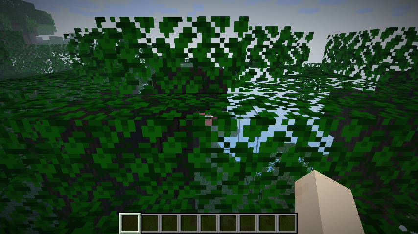
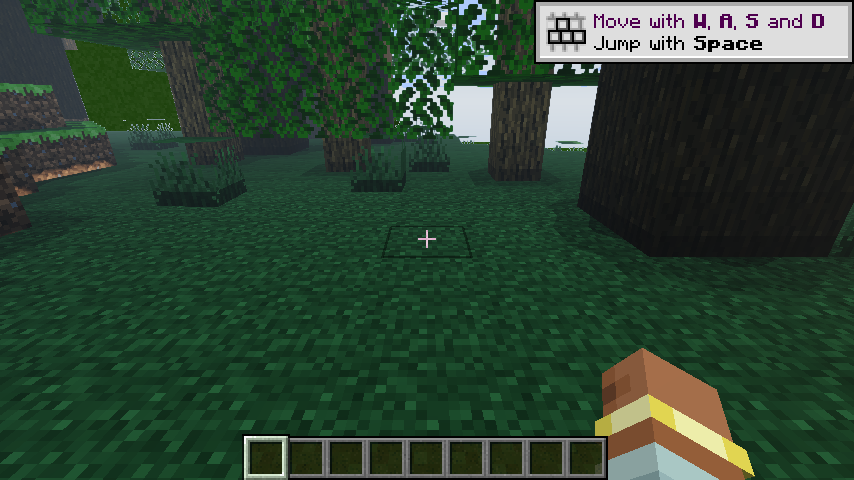
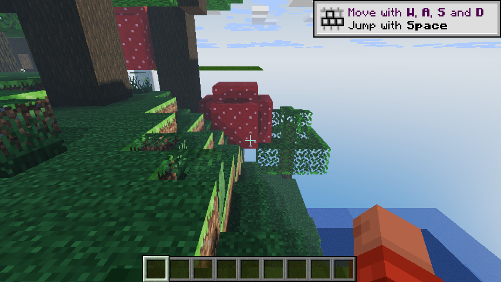

<p align="center">
  
</p>

# AerogelVK

**AerogelVK** is a Vulkan 1.3 GPU-driven voxel deferred renderer and native OptiFine/Iris shaderpack pipeline mod for **Minecraft 1.21.1 (Fabric)**.

- **Mod ID:** `aerogelvk`
- **Java Package:** `org.sakus.aerogelvk`
- **Target:** Minecraft `~1.21.1`, Fabric Loader `>=0.16.0`, Java `>=21` , Cloth Config API
- **License:** [LGPL-3.0-only](LICENSE)

---

## Key Features

- **Vulkan 1.3 GPU-Driven Terrain Pipeline**
  - 64-bit packed vertex format (`8 bytes/vertex`) & `VkMegaBuffer` chunk allocation.
  - Compute-driven frustum/occlusion culling (`chunk_cull.comp`) & Hi-Z depth pyramid (`hiz_downsample.comp`).
  - Reversed-Z depth precision with Standard-Z conversion (`depth_convert`), Cascaded Shadow Maps (`csm_shadow`), deferred lighting (`deferred_lighting.comp`), and post-composite (`post_composite.comp`).
- **OpenGL + Vulkan Interop**
  - Shares framebuffer output with Minecraft's OpenGL context via `VK_KHR_external_memory` / `VK_KHR_external_semaphore` (with fallback support when external semaphore extensions are unavailable, such as on `llvmpipe`).
- **Native OptiFine / Iris Shaderpack Support**
  - Runtime preprocessor (`#include`, `#ifdef`, `#if`, `DRAWBUFFERS`, `colortexFormat`) and GLSL-to-Vulkan 460 transpiler (`GlslToVulkanTranspiler`) compiled to SPIR-V via `shaderc`.
  - Supports `shadow`, `prepare`, `gbuffers_terrain`, `gbuffers_water`, `deferred`, `composite`, and `final` passes, plus `shaders.properties` custom uniforms/variables with dependency-ordered resolution.
- **Mod Compatibility**
  - Designed to coexist with optimization and world mods (such as Sodium, Lithium, Iris, Distant Horizons, C2ME, ModernFix, FerriteCore, FastQuit, etc.).

---

## Verification Screenshots

Captured during in-game Fabric client smoke tests (`runRenderSmokeClient` / `runProdCompatSmokeClient`):

| Base Render Smoke Test | Mod Compat Smoke Test | Full Modpack Compat Smoke Test |
| :---: | :---: | :---: |
|  |  |  |

---

## Shaderpack Verification (`verifyValkyrie`)

All **14** tested OptiFine/Iris shaderpacks compile cleanly (`218` passes / `436` SPIR-V modules, `0` shaderc errors) and pass headless Vulkan 1.3 rendering verification (`4096/4096` non-black pixels on `64x64` synthetic test scene) on both **Intel(R) HD Graphics 530 (SKL GT2)** and **llvmpipe (LLVM 20.1.2, 256 bits)**:

| Shaderpack | Passes | Intel HD 530 `avgLuma` | Intel HD 530 `distinctColors` |
| :--- | :---: | :---: | :---: |
| `BSL_v10.1.8.zip` | 14 | 116.98 | 4074 |
| `ComplementaryReimagined_r5.9.3.zip` | 12 | 94.40 | 4088 |
| `ComplementaryUnbound_r5.9.3.zip` | 12 | 91.89 | 4084 |
| `MakeUp-UltraFast-9.6.zip` | 9 | 2.83 *(2f)* / 105.14 *(120f)* | 152 *(2f)* / 4070 *(120f)* |
| `Mellow v3.5.zip` | 20 | 94.74 | 1586 |
| `PotatoShaders_v1.0d.zip` | 11 | 85.82 | 4058 |
| `Sildur's Enhanced Default v1.20 Fancy.zip` | 5 | 64.87 | 3970 |
| `Sildur's Vibrant Shaders v2.02 Extreme.zip` | 9 | 79.00 | 3742 |
| `Simplicissimus_v1.3a.zip` | 8 | 82.56 | 4045 |
| `Tea_V2.0.0_Dev7.zip` | 11 | 113.33 | 4073 |
| `VanillaPlus_v3.3.zip` | 17 | 55.63 | 3922 |
| `YoFPS+High+(Chocapic13+Edit).zip` | 3 | 163.68 | 4088 |
| `miniature-shader-2.19.zip` | 4 | 114.55 | 4076 |
| `superDuperVanilla.zip` | 14 | 28.66 | 214 |

> **Note on `MakeUp-UltraFast-9.6.zip`:** Its `composite.vsh` performs temporal auto-exposure (`gaux3Clear = false`), so at frame 2 from a cold start it is ~4.1% converged (`avgLuma = 2.83`) and converges to `avgLuma = 105.14` (`distinctColors = 4070`) by frame 120.

---

## Known Limitations

- **Non-full block geometry (0.5-block quantization):** `VoxelShape` meshing currently quantizes non-full blocks at `0.5`-block granularity. Stairs and slabs are represented well, whereas thinner shapes (fence posts at 0.25 width, crops, doors/trapdoors, etc.) are approximated at 0.5-block resolution.
- **Headless verification vs. in-game FPS:** `verifyValkyrie` validates correctness and synthetic scene rendering in headless mode (`64x64` / `1280x720`); it is not an in-game FPS benchmark.

---

## Build & Verification

Requires **Java 21** and Vulkan 1.3 capable drivers (or `llvmpipe` via `AEROGELVK_VK_DEVICE=llvmpipe`).

```bash
# Build mod jar and run unit tests
./gradlew build

# Run Vulkan 1.3 & 14-shaderpack verification suite
./gradlew verifyValkyrie

# Run verification suite on software Vulkan (llvmpipe)
AEROGELVK_VK_DEVICE=llvmpipe ./gradlew verifyValkyrie

# Run in-game Fabric client smoke tests (requires display or xvfb-run)
./gradlew runRenderSmokeClient runProdCompatSmokeClient
```

---

## License

This project is licensed under the **GNU Lesser General Public License v3.0 only** (`LGPL-3.0-only`). See [LICENSE](LICENSE) for details.
